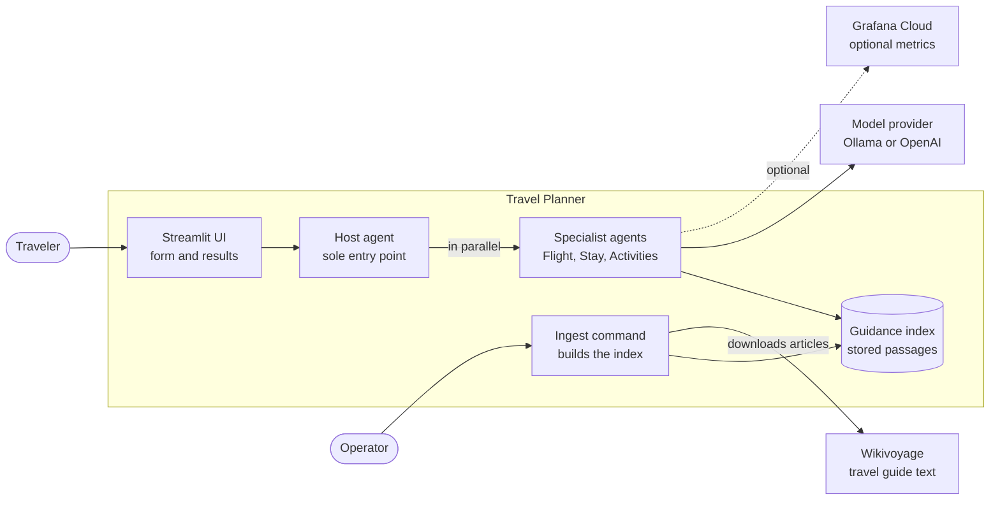
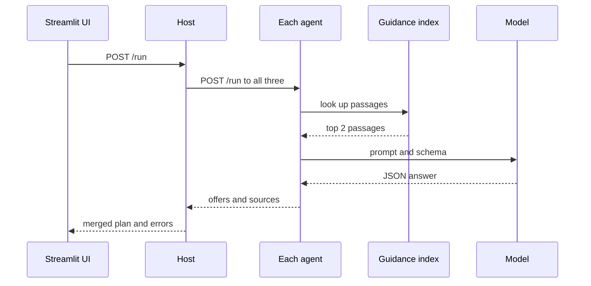
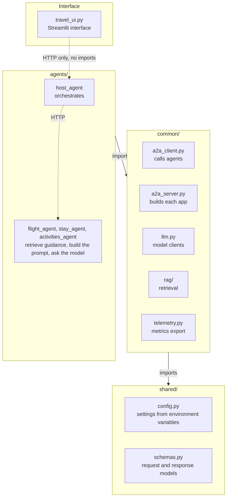
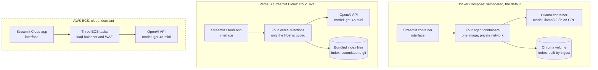

# Software Design Document: ADK-Powered Travel Planner

Structured according to IEEE Std 1016-2009 (IEEE Standard for Information Technology, Systems Design, Software Design Descriptions).

| Field | Value |
| --- | --- |
| Project title | ADK-Powered Travel Planner |
| Document version | 1.0.0 |
| Date | October 5, 2026 |
| Organization | To be confirmed |
| Authors | Chaim Joseph Cordova, Psalmantha Allaine Ipong |
| Status | Draft |

## 1. Introduction

### 1.1 Purpose

This document describes the design of the ADK-Powered Travel Planner, a multi-agent web application that suggests flights, accommodation, and activities for a trip. It records how the software is divided into components, how those components communicate, what data they hold, and how the system is deployed.

It is written for the project's developers and maintainers, for evaluators assessing the design, and for anyone deploying or extending the system. Each design viewpoint in section 3 follows IEEE Std 1016-2009 and describes the system as built in the repository `4-Shades/IS_Final` at version 1.0.0.

### 1.2 Scope

The software takes a trip request (origin, destination, dates, budget, travellers) and returns a trip plan with two or three suggestions each for flights, stays, and activities, plus the sources of any travel guidance used.

**In scope**

- A Host agent that coordinates three specialist agents: Flight, Stay, and Activities.
- Structured generation from a language model, either Ollama (self-hosted) or OpenAI (cloud).
- Retrieval-augmented generation (RAG) from Wikivoyage travel-guide articles.
- A Streamlit web interface.
- Three deployment targets: self-hosted, Vercel, and a dormant AWS and Railway deployment.

**Out of scope**

- Live availability, live prices, and booking. All suggestions are illustrative.
- User accounts and stored trip history. The system keeps no user data.

**Goals and benefits**

- **Run at no cost.** The self-hosted setup needs no paid service. The Vercel deployment costs nothing while idle.
- **Degrade, don't fail.** A failed agent or a failed guidance lookup removes one part of a plan, never the whole plan.
- **Stay verifiable.** Every model answer is checked against a fixed schema, and every guidance passage carries its source and license.

### 1.3 Definitions, Acronyms, and Abbreviations

| Term | Meaning |
| --- | --- |
| Agent | A small web service with one job. The system has four: Host, Flight, Stay, Activities. |
| Host | The agent that receives a trip request and calls the other three. |
| ADK | Agent Development Kit. The project name comes from an earlier design based on Google's ADK; the current agents are plain FastAPI services. |
| LLM | Large language model. Here, `llama3.2:3b` on Ollama or `gpt-4o-mini` on OpenAI. |
| Ollama | Software that runs open language models on a local machine. |
| RAG | Retrieval-augmented generation: adding retrieved reference text to a model's prompt. |
| Embedding | A list of numbers representing a text's meaning, used to find similar passages. |
| Vector store | A store of embeddings that can be searched by similarity. Here, Chroma or LlamaIndex's built-in store. |
| Guidance index | The vector store of Wikivoyage passages the agents search. |
| Pydantic | The Python library used to define and validate data models. |
| FastAPI | The Python web framework each agent is built on. |
| Streamlit | The Python framework the web interface is built on. |
| Service binding | A private link between two Vercel services, delivered as a URL in an environment variable. |
| OTLP | OpenTelemetry Protocol, used to send metrics to Grafana Cloud. |
| WAF | Web application firewall. |
| OIDC | OpenID Connect, used by CI to sign in to AWS without stored keys. |
| SSM | AWS Systems Manager Parameter Store, used to hold secrets on AWS. |
| CI | Continuous integration: the automated tests run on every push. |

## 2. References

### 2.1 Document References

The design is described from the source code and its documentation; the external documents below define the standards, platforms, and libraries it relies on.

| Reference | Used for |
| --- | --- |
| IEEE Std 1016-2009, IEEE Standard for Information Technology, Systems Design, Software Design Descriptions | The structure of this document |
| [Project repository, 4-Shades/IS_Final](https://github.com/4-Shades/IS_Final) | Source code, `README.md`, and the documentation site in `docs/` |
| Project documentation, `docs/explanation/` (architecture, component design, security model, cloud design and costs) | Design reasoning and measured figures quoted here |
| [FastAPI documentation](https://fastapi.tiangolo.com) | The agents' web framework |
| [Pydantic documentation](https://docs.pydantic.dev) | Data contracts and validation |
| [Ollama](https://ollama.com) | Self-hosted language model runtime |
| OpenAI API reference, Chat Completions structured outputs and Embeddings | Cloud language model and embeddings |
| [LlamaIndex](https://www.llamaindex.ai) | Text splitting, embeddings, and retrieval |
| [Chroma](https://www.trychroma.com) | Vector store for self-hosted retrieval |
| [Wikivoyage](https://en.wikivoyage.org) and the MediaWiki API | Source of travel guidance |
| [Creative Commons BY-SA 4.0](https://creativecommons.org/licenses/by-sa/4.0/) | License of the Wikivoyage text |
| [Streamlit](https://streamlit.io) | Web interface |
| [Vercel Services](https://vercel.com/docs/services) and [Vercel Functions limits](https://vercel.com/docs/functions/limitations) | Vercel deployment model and limits |
| [OpenTelemetry](https://opentelemetry.io) | Metrics format and export |
| [Diátaxis](https://diataxis.fr) | Organization of the project documentation |

No separate requirements specification exists for this project; the scope in section 1.2 states the requirements the design meets.

## 3. IEEE 1016 Design Viewpoints

### 3.1 Context Viewpoint

This viewpoint treats the system as a single unit and shows who uses it and what it depends on outside its boundary.



A traveler reaches the system only through the Streamlit UI, which calls the Host. The specialist agents, not the Host, call the model provider. The dashed line is optional: metrics are sent only when an endpoint is configured.

**Users**

| Actor | Goal | How they interact |
| --- | --- | --- |
| Traveler | Get flight, stay, and activity suggestions for a trip | Fills in origin, destination, dates, and budget in the web interface; reads the plan and its sources |
| Operator | Run, deploy, and maintain the system | Starts the stack, sets environment variables, builds the guidance index, and reads logs and metrics |
| API client | Use the planner from another program | Sends `POST /run` to the Host with an `X-API-Key` header |

**External systems**

| System | Role | When it is called | If it is unavailable |
| --- | --- | --- | --- |
| Ollama | Local chat and embedding models | Every request, when `LLM_PROVIDER=ollama` | The affected part of the plan reports an error |
| OpenAI API | Hosted chat and embedding models | Every request, when `LLM_PROVIDER=openai`; also when building the Vercel index | The affected part of the plan reports an error |
| Wikivoyage (MediaWiki API) | Source of travel guidance | Only when the index is built, never during a request | The index cannot be rebuilt; existing plans are unaffected |
| Grafana Cloud | Stores and charts metrics | Periodically, when an OTLP endpoint is configured | No effect on requests |

**Hosting platforms.** Docker (a local machine), Vercel and Streamlit Community Cloud (current cloud deployment), and AWS ECS (dormant) run the system but are not part of its logic; section 4.1 covers them.

**Boundary.** The system does not search live inventory, quote real prices, or make bookings. It stores no user accounts and no trip history.

### 3.2 Composition Viewpoint

The system is four agent services, one web interface, and two shared packages that every agent imports. All four agents are built from the same codebase and differ only in which module they start.

**Subsystems**

| Subsystem | Package or file | Responsibility |
| --- | --- | --- |
| Host agent | `agents/host_agent/` | Receives a trip request, calls the three specialist agents in parallel, and merges their answers, errors, and sources into one trip plan. Makes no model calls. |
| Flight agent | `agents/flight_agent/` | Suggests flights for the trip. |
| Stay agent | `agents/stay_agent/` | Suggests accommodation. |
| Activities agent | `agents/activities_agent/` | Suggests activities, using the traveller's preferences. |
| Web interface | `travel_ui.py` | Collects the trip form, shows progress, and displays results, warnings, and sources. |
| Shared contracts and settings | `shared/` | Data models for every request and response (`schemas.py`) and all configuration (`config.py`). |
| Common services | `common/` | Service plumbing, language-model access, retrieval, and metrics, used by every agent. |

**Modules inside each specialist agent**

| Module | Responsibility |
| --- | --- |
| `__main__.py` | Builds the agent's web application. |
| `task_manager.py` | Handles a `/run` request by calling `execute`. |
| `agent.py` | Looks up guidance, builds the prompt, calls the model, and returns the result with its sources. |

**Modules in `common/`**

| Module | Responsibility |
| --- | --- |
| `a2a_server.py` | Application factory: gives every agent the same endpoints, request logging, optional API-key check, and metrics. |
| `a2a_client.py` | The Host's HTTP client for calling an agent. Converts any failure into an error response instead of raising. |
| `serve.py` | Process entry point: starts the agent named by `APP_MODULE` on `PORT`. |
| `llm.py` | One interface over two model providers. Requests schema-constrained JSON, validates it, and records call metrics. |
| `rag/wikivoyage.py` | Downloads a Wikivoyage article and splits it into sections. |
| `rag/ingest.py` | Command-line tool that builds the guidance index. |
| `rag/store.py` | Settings shared by both vector stores: agent sections, embedding model, and store selection. |
| `rag/chroma_store.py` | Chroma vector store, used when self-hosted. |
| `rag/simple_store.py` | LlamaIndex file-based vector store, used on Vercel. |
| `rag/retrieve.py` | Looks up guidance passages for one agent and one destination. |
| `rag/types.py` | The guidance result type, importable without the retrieval libraries. |
| `telemetry.py` | Optional export of metrics over OTLP. |
| `travel_data.py` | Clients for geocoding, places, and weather. Tested, but not called by any agent in this version. |

**Supporting parts**

| Part | Files | Responsibility |
| --- | --- | --- |
| Local runners | `run.py`, `compose.yaml`, `Dockerfile` | Start the whole system without Docker or in containers. |
| Deployment configuration | `vercel.json`, `infra/aws/` | Define the Vercel services and the AWS infrastructure. |
| Continuous integration | `.github/workflows/ci.yml` | Tests and lint on every push. |
| Tests | `tests/` | 59 automated tests that need no external service. |

### 3.3 Logical Viewpoint

This viewpoint describes the system's main types and how they work together to answer one request. All data models are Pydantic classes in `shared/schemas.py`, shared by every service.

**Data models**

| Model | Purpose | Key fields |
| --- | --- | --- |
| `TravelRequest` | One trip request | `origin`, `destination`, `start_date`, `end_date`, `budget`, `currency`, `travellers`, `preferences`, `request_id`, `trip_id` |
| `FlightOffer`, `StayOffer`, `ActivityOffer` | One suggestion of each kind | Name or airline, price, currency, and details such as stops, location, or duration |
| `FlightResponse`, `StayResponse`, `ActivitiesResponse` | What the model must produce | A list of offers and an optional `error` |
| `FlightAgentResponse`, `StayAgentResponse`, `ActivitiesAgentResponse` | What an agent returns to the Host | The model's response plus `sources` |
| `SourceCitation` | Where a guidance passage came from | `title`, `url`, `license` |
| `ServiceError` | One failed part of a plan | `service`, `message` |
| `TripPlanResponse` | The complete plan | `flights`, `stay`, `activities`, `errors`, `sources`, `request_id`, `trip_id` |

**Rules the models enforce**

- `end_date` must be after `start_date`; `budget` must be above zero; `travellers` is between 1 and 9.
- Locations have extra spaces removed; `currency` is three letters, stored in upper case.
- An agent response must contain at least one offer or an explicit error. An empty answer is invalid.
- Prices cannot be negative.
- The agent response classes extend the model response classes. Only the base classes are sent to the model as its output format, so the model has no `sources` field to fill in.

**Logical classes**

| Class or function | Location | Responsibility |
| --- | --- | --- |
| `create_app` | `common/a2a_server.py` | Builds each agent's web application: `/run`, health check, API-key check, request IDs |
| `run` (Host) | `agents/host_agent/task_manager.py` | Calls the three agents at once, validates each answer, and merges them |
| `call_agent` | `common/a2a_client.py` | One HTTP call to an agent; turns every failure into an error value |
| `OllamaClient`, `OpenAICompatibleClient` | `common/llm.py` | Ask a model for JSON matching a schema, then validate it; raise `LLMError` on any failure |
| `retrieve_guidance` | `common/rag/` | Returns a `Guidance` value (prompt text and sources), or an empty one |
| `Settings` | `shared/config.py` | Read-only configuration loaded once from environment variables |

**Behavior: one trip request**



Solid arrows are calls and dashed arrows are replies. Everything between the first and last arrow runs three times at once, once per specialist agent.

1. The UI sends the trip details to the Host, which validates them as a `TravelRequest` and assigns a request ID.
2. The Host sends the same request to Flight, Stay, and Activities at the same time.
3. Each agent looks up guidance for the destination and its own topic. If nothing is found, it continues without it.
4. Each agent builds a prompt from the request and the guidance, and asks the model for JSON in its response format.
5. The agent validates the answer. Valid offers are returned with their sources; anything else becomes an `error`.
6. The Host validates each agent's answer, collects errors into `errors`, removes duplicate sources by URL, and returns one `TripPlanResponse`.
7. The UI shows each part of the plan, a warning for any part that failed, and the list of sources.

### 3.4 Dependency Viewpoint

This viewpoint shows which parts need which others, in code and at run time.



Solid arrows are Python imports between layers; dashed arrows are HTTP calls. No lower layer imports a higher one, and the interface shares no code with the agents.

**Module dependencies**

| Module | Depends on | Needed by |
| --- | --- | --- |
| `shared/config.py`, `shared/schemas.py` | Pydantic only | Everything else |
| `common/a2a_server.py` | `shared`, `common/telemetry.py`, FastAPI | All four agents |
| `common/a2a_client.py` | httpx | Host only |
| `common/llm.py` | `shared`, httpx | Flight, Stay, Activities |
| `common/rag/` | `shared`, LlamaIndex; Chroma only for the `chroma` store | Flight, Stay, Activities; the ingest command |
| `common/telemetry.py` | OpenTelemetry | The app factory and model clients |
| `agents/host_agent` | `shared`, `common/a2a_client.py`, `common/a2a_server.py` | The interface, over HTTP |
| `agents/flight_agent`, `stay_agent`, `activities_agent` | `shared`, `common/a2a_server.py`, `common/llm.py`, `common/rag/` | The Host, over HTTP |
| `travel_ui.py` | Streamlit, an HTTP client | Nothing |

**Optional dependencies**

The retrieval packages are imported only when retrieval is first used. An agent installed without them starts normally and plans without guidance. Chroma is imported only when the Chroma store is selected, which is what lets the Vercel functions leave it out.

**Run-time dependencies**

| Service | Requires at run time | Optional |
| --- | --- | --- |
| Interface | Host URL; the API key if the Host enforces one | None |
| Host | URLs of the three agents | Metrics endpoint |
| Flight, Stay, Activities | A model provider (Ollama or OpenAI) | Guidance index and an embedding model; metrics endpoint |
| Ingest command | Wikivoyage; an embedding model | None |

**Startup order**

Under Docker Compose, health checks enforce the order:

1. Flight, Stay, and Activities start and report healthy.
2. The Host starts once all three are healthy.
3. The interface starts once the Host is healthy.

Ollama, when used, runs under its own Compose profile and must have its models pulled before the first request. The agents do not wait for it; a request made too early returns an error for each part rather than failing to start. The index is built separately by the ingest profile and is not needed for startup.

On Vercel there is no startup order. Each function starts on its first request, and the Host receives the agents' addresses through service bindings set at deployment.

### 3.5 Information Viewpoint

The system has no transactional database and stores no user data. Its only persistent data is the guidance index, built ahead of time and read-only while serving requests. Everything else lives for one request or one process.

**Data stores**

| Data | Where it lives | Written by | Lifetime |
| --- | --- | --- | --- |
| Guidance index, self-hosted | Chroma database in `data/rag/index/` (a Docker volume under Compose) | The ingest command, one destination at a time | Until rebuilt. Not in version control. |
| Guidance index, Vercel | JSON files in `data/rag/vercel/`, committed to the repository (22 MB, 1,613 passages) | The ingest command, rebuilt in full | Ships inside each deployment. |
| Alias map | `aliases.json` beside each index | The ingest command | Same as its index. |
| Downloaded articles | `data/rag/cache/` | The ingest command | Reused for 30 days. Not in version control. |
| Destination list | `data/rag/destinations.txt` | Maintainers | Version controlled. 20 destinations. |
| Settings | Environment variables, `.env` locally | Operators | Read once per process. |
| Secrets | `.env` locally; Vercel environment variables; AWS SSM on AWS; Streamlit secrets for the UI | Operators | Never in version control. |
| Lookup cache | Agent process memory | The retrieval module | Up to 256 entries, keyed by agent, destination, and day. |
| Logs | Standard output; platform log viewers | Agents | One hour on Vercel's free plan. |
| Metrics | Grafana Cloud, when configured | Agents, once a minute | Per Grafana Cloud retention. |

**Guidance passage record**

Each passage in the index is about 300 tokens of article text plus this metadata:

| Field | Example | Purpose |
| --- | --- | --- |
| `destination` | `Paris` | Display name. |
| `destination_key` | `paris` | Lower-cased, space-normalized name used for filtering. |
| `section` | `Sleep` | The article section it came from; decides which agent may use it. |
| `title` | `Wikivoyage: Paris, Sleep` | Shown to the user as the source title. |
| `source_url` | `https://en.wikivoyage.org/wiki/Paris#Sleep` | Shown to the user as the source link. |
| `revision_id` | `5357007` | The article revision the text was taken from. |
| `license` | `CC BY-SA 4.0` | Attribution requirement. |
| `language` | `en` | Only English passages are retrieved. |
| `access_policy` | `curated` | Only `curated` or `internal` passages are retrieved. |
| `effective_ymd`, `expiry_ymd` | `20260930`, `20270930` | Validity window as integers. Passages expire one year after download. |

Passage identifiers are stable, in the form `paris|Sleep|3`, so re-ingesting a destination replaces its passages instead of duplicating them.

**Embedding identity**

Every index records the embedding model that built it, for example `openai:text-embedding-3-small:512` or `ollama:embeddinggemma`. Vectors from different models cannot be compared, so an agent whose settings name a different identity disables retrieval and logs the mismatch.

**Request data lifecycle**

1. The web interface builds a trip request and sends it to the Host.
2. The Host validates it, assigns `request_id` and `trip_id` if absent, and forwards it unchanged to the three agents.
3. Each agent validates the model's answer, attaches sources, and returns it.
4. The Host validates each answer and returns the merged trip plan.
5. Nothing is stored. Only log lines and metric counts outlive the request.

**Formats**

All messages are JSON over HTTP. Dates are ISO 8601 (`YYYY-MM-DD`), currencies are three-letter codes, and identifiers are UUIDs. Section 3.7 gives the full payloads.

### 3.6 Patterns Viewpoint

The same few patterns recur across the modules; each was chosen to keep a partial failure from becoming a total one, or to let the same code run in every environment.

| Pattern | Where it is applied | Why |
| --- | --- | --- |
| Orchestrator with parallel fan-out | The Host sends one request to three agents with `asyncio.gather` and merges the results | A plan takes as long as the slowest agent, not the sum of all three. |
| Microservices from one codebase | Four services share one image; `APP_MODULE` selects the agent | One build and one artifact for every service and platform. |
| Application factory | `create_app` in `common/a2a_server.py` | Every agent gets identical endpoints, logging, key check, and metrics. |
| Shared contracts | Pydantic models in `shared/schemas.py`, validated at every boundary | A malformed message is caught where it is produced. |
| Strategy | `LLMClient` with `OllamaClient` and `OpenAICompatibleClient`; vector stores with a common `load` and `Writer` | Model provider and vector store are chosen by a setting, not by code changes. |
| Constrain, then verify | The model's output is limited by a JSON schema, then validated with Pydantic | Constraining makes valid output likely; validating makes invalid output impossible to pass on. |
| Graceful degradation | The agent client, the agents' model calls, and retrieval all return an explained empty result instead of raising | One failed part is reported inside the plan; the rest still reaches the user. |
| Fail-quiet optional features | Retrieval, the API key, and metrics are each off or harmless unless configured | The simplest local setup needs no accounts, keys, or index. |
| Lazy loading | Retrieval libraries and the Chroma store are imported only when used; the index loads on first lookup | Deployments without those packages still run, and start faster. |
| Offline build, online read | The guidance index is built by a separate command and only read while serving | Slow work happens once; a request only embeds one short query. |
| Twelve-factor configuration | All settings come from environment variables through one frozen `Settings` object | Identical code runs locally, in Docker, on Vercel, and on AWS. |
| Untrusted-input fencing | Retrieved text is wrapped in `<guidance>` markers, stripped of those markers, and length-capped | Limits what edited web text could make the model do. |
| Infrastructure as code | Terraform modules for AWS; `vercel.json` for Vercel | Deployments are reproducible and reviewable. |
| Disposable infrastructure | On AWS, a permanent low-cost module and a costly module that is destroyed between uses | Fixed charges accrue only while the system is in use. |

### 3.7 Interface Viewpoint

Every agent exposes the same four HTTP endpoints; only the body returned by `POST /run` differs. Clients call only the Host.

**Endpoints (all agents)**

| Method and path | Purpose | Response |
| --- | --- | --- |
| `POST /run` | Plan a trip (Host) or one part of it (other agents) | See response bodies below |
| `GET /healthz` | Liveness check, never guarded by the API key | `{"status": "ok", "service": "<name>"}` |
| `GET /readyz` | Readiness check | `{"status": "ready", "service": "<name>"}` |
| `GET /` | Service identity | `{"service": "<name>", "status": "ok", "health": "/healthz"}` |

Local ports are 8000 (Host), 8001 (Flight), 8002 (Stay), and 8003 (Activities). Each service also serves its OpenAPI schema at `/openapi.json`.

**Request headers for `POST /run`**

| Header | Required | Meaning |
| --- | --- | --- |
| `Content-Type: application/json` | Yes |  |
| `X-API-Key` | Host only, when `HOST_API_KEY` is set | Must equal the configured key. |
| `X-Request-ID` | No | Used as the request identifier in logs. The Host sends it to the other agents. |

**Request body: travel request**

| Field | Type | Required | Rules |
| --- | --- | --- | --- |
| `origin` | string | Yes | 2 to 120 characters |
| `destination` | string | Yes | 2 to 120 characters |
| `start_date` | date | Yes | `YYYY-MM-DD` |
| `end_date` | date | Yes | After `start_date` |
| `budget` | number | Yes | Greater than 0 |
| `currency` | string | No, default `USD` | Three letters |
| `travellers` | integer | No, default 1 | 1 to 9 |
| `preferences` | array of strings | No | At most 20; used by the Activities agent |
| `request_id`, `trip_id` | string | No | Generated if absent |
| `user_id` | string | No | At most 128 characters |

**Response body: trip plan (Host)**

| Field | Type | Meaning |
| --- | --- | --- |
| `request_id`, `trip_id` | string | Echoed or generated identifiers |
| `flights` | array of flight offers | `airline`, `departure_time`, `return_time`, `price`, `currency`, `stops`, `booking_url` |
| `stay` | array of stay offers | `name`, `location`, `price_per_night`, `currency`, `booking_url` |
| `activities` | array of activity offers | `name`, `description`, `price`, `currency`, `duration_hours`, `source_url` |
| `errors` | array | One entry per failed agent: `service` and `message` |
| `sources` | array | Guidance used: `title`, `url`, `license` |

The Flight, Stay, and Activities agents return their own list (`flights`, `stays`, or `activities`) with `error` and `sources`. Each must contain at least one offer or an `error`.

**Status and error codes**

| Code or message | Returned by | Meaning |
| --- | --- | --- |
| `200` | All | Request handled. The Host returns `200` even when some agents fail; see `errors`. |
| `401` | Host | `X-API-Key` missing or wrong while a key is configured. |
| `422` | All | The request body failed validation. |
| `Service is temporarily unavailable.` | Host, in `errors` | The Host could not reach the agent, or stopped waiting for it. |
| `Flight planner is temporarily unavailable.` (also `Stay planner`, `Activity planner`) | Agent, in `error` | The agent was reached, but its model call failed, timed out, or returned invalid JSON. |

**Internal interfaces**

| Interface | Signature | Contract |
| --- | --- | --- |
| Agent work function | `execute(request) -> response` | Never raises for a model failure; returns a response with `error` set. |
| Agent client | `call_agent(url, payload, request_id, timeout_seconds) -> dict` | Never raises; returns `{"error": ...}` on any failure. |
| Language model | `LLMClient.generate_structured(prompt, response_type)` | Returns a validated model instance or raises `LLMError`. |
| Retrieval | `retrieve_guidance(agent, destination) -> Guidance` | Never raises; returns an empty `Guidance` when nothing is available. |
| Vector store | `load(index_dir, identity, embed_model)` and `Writer.replace` / `Writer.finish` | Raises `IndexUnavailable` when the index is missing or mismatched. |

**External interfaces**

| Service | Protocol | Used for |
| --- | --- | --- |
| Ollama | HTTP, `POST /api/chat` with a JSON schema in `format`; embeddings API | Generation and embeddings when self-hosted |
| OpenAI | HTTPS, `POST /v1/chat/completions` with a strict `json_schema` response format; `POST /v1/embeddings` | Generation and embeddings in the cloud |
| Wikivoyage | HTTPS, MediaWiki API `action=query` with plain-text extracts | Downloading articles at ingest time only |
| Grafana Cloud | HTTPS, OTLP metrics | Optional metrics export |

### 3.8 Structure Viewpoint

The system lives in one Git repository, `4-Shades/IS_Final` on GitHub, branch `main`. It targets Python 3.11.

**Directory structure**

```text
IS_Final/
├── agents/                  Host, Flight, Stay, and Activities agents
├── common/                  Service plumbing, language models, retrieval (rag/), metrics
├── shared/                  Data contracts (schemas.py) and settings (config.py)
├── tests/                   Automated tests and fixtures
├── data/rag/                destinations.txt and the committed Vercel index (vercel/)
├── docs/                    Documentation site (Mintlify)
├── infra/aws/               Terraform modules: foundation, ecs-agents
├── infra/grafana/           Importable Grafana dashboard
├── infra/ollama/            Ollama image for a separate server
├── infra/kubernetes/        Kubernetes manifest for Ollama
├── requirements/            Dependency sets (see below)
├── .github/workflows/       CI workflow
├── .devcontainer/           Dev container that runs the UI
├── travel_ui.py             Streamlit web interface
├── run.py                   Starts all services without Docker
├── Dockerfile               Agent and UI images
├── compose.yaml             Local container stack
├── vercel.json              Vercel service definitions
└── requirements.txt         Streamlit Cloud entry point
```

**Dependency sets**

| File | Contents | Installed by |
| --- | --- | --- |
| `requirements/api-core.txt` | FastAPI, Uvicorn, httpx, Pydantic, python-dotenv, OpenTelemetry | The Host on Vercel; included by the two sets below |
| `requirements/api.txt` | Core plus LlamaIndex, Chroma, and Ollama and OpenAI embeddings | The Docker agent image and local development |
| `requirements/api-vercel.txt` | Core plus LlamaIndex core and OpenAI embeddings, without Chroma | Flight, Stay, and Activities on Vercel |
| `requirements/ui.txt` | Streamlit and requests | The UI image and Streamlit Cloud |
| `requirements/dev.txt` | Agent and UI sets plus pytest and ruff | Developers and CI |

All versions are pinned. Key pins: FastAPI 0.115.12, Pydantic 2.11.5, LlamaIndex core 0.14.25, Chroma 1.5.9, Streamlit 1.45.1.

**Build artifacts**

| Artifact | Built from | Size | Used by |
| --- | --- | --- | --- |
| Agent container image (`api-runtime`) | `Dockerfile`, default target | About 716 MB | Docker Compose; AWS ECS through ECR |
| UI container image (`ui-runtime`) | `Dockerfile`, `ui-runtime` target | About 589 MB | Docker Compose |
| Vercel function, Host | `vercel.json` with `api-core.txt` | About 19 MB compressed | Vercel |
| Vercel functions, Flight, Stay, Activities | `vercel.json` with `api-vercel.txt` and the index | About 73 MB compressed, 226 MB uncompressed | Vercel |
| Guidance index, Vercel | `python -m common.rag.ingest --store simple` | 22 MB | Bundled in the Vercel functions |
| Guidance index, self-hosted | `python -m common.rag.ingest` | Depends on destinations | A local folder or Docker volume |

The agent image is built once and runs as any of the four agents; `APP_MODULE` and `PORT` choose which.

## 4. Operational & Deployment Design

### 4.1 Deployment Architecture

The same code runs on three targets. Only configuration differs: which model provider, which index store, and where the services live.



Docker Compose is the default and costs nothing to run. Vercel is the live cloud deployment. The AWS deployment, drawn with a dashed border, is switched off to avoid charges and can be restored from its Terraform code.

**Target 1: Docker Compose (self-hosted)**

| Item | Design |
| --- | --- |
| Services | Interface, Host, Flight, Stay, Activities, and Ollama, each in its own container |
| Images | One `Dockerfile` with two build targets: the agent image, shared by all four agents, and the interface image |
| Network | Agents sit on a private network; only the interface publishes a port |
| Model | Ollama with `llama3.2:3b` for chat and `embeddinggemma` for embeddings |
| Index | Chroma, in a named volume, built by `docker compose --profile ollama --profile ingest run --rm ingest` |
| Without Docker | `run.py` starts the four agents and the interface as local processes |

**Target 2: Vercel with Streamlit Community Cloud (live)**

| Item | Design |
| --- | --- |
| Services | Four Vercel functions declared in `vercel.json`, one per agent, built from the same repository root |
| Routing | Every public path is rewritten to the Host; the Host reaches the others through service bindings that supply their addresses as environment variables |
| Dependencies | The Host installs the core set; the three specialists add LlamaIndex and the OpenAI embedding package, without Chroma |
| Model | OpenAI `gpt-4o-mini` for chat and `text-embedding-3-small` at 512 dimensions for embeddings |
| Index | Plain files in `data/rag/vercel/`, built locally, committed, and bundled read-only into each specialist function |
| Interface | The Streamlit app on Streamlit Community Cloud, with the Host address and API key in its secrets |
| Platform setting | `VERCEL_SUPPORT_LARGE_FUNCTIONS=1`, because the specialist functions exceed the default size limit for custom install commands |

**Target 3: AWS ECS (dormant)**

| Item | Design |
| --- | --- |
| Services | Host, Stay, and Activities as ECS tasks; Flight ran on Railway and is paused |
| Entry | An application load balancer with a web application firewall and access logs |
| Infrastructure code | Two Terraform stacks: `foundation` (network, roles, image registries, log bucket, CI role) is kept; `ecs-agents` (tasks, load balancer, firewall, schedules) is destroyed when not in use |
| Secrets | AWS SSM Parameter Store, read by the tasks at start |
| Status | Spun down. Restoring it means applying `ecs-agents` again; retrieval has not been deployed there |

**Build and release**

| Step | Trigger | What happens |
| --- | --- | --- |
| Test and lint | Every push and pull request | GitHub Actions runs pytest and ruff |
| Vercel deployment | Vercel CLI or a push, as configured | Each function is built with its own install command |
| Image push to AWS | Push to `main`, only while the `AWS_ROLE_ARN` repository variable exists | Images are built and pushed to the registries. Terraform creates the variable with the ECS stack and removes it on destroy, so the step is skipped while AWS is dormant |
| Index rebuild | Manual, when destinations change | The ingest command is run locally and, for Vercel, the result is committed |

**Configuration**

All settings come from environment variables read once by `shared/config.py`. The ones that differ by target:

| Variable | Docker Compose | Vercel |
| --- | --- | --- |
| `LLM_PROVIDER` | `ollama` | `openai` |
| `RAG_STORE` | `chroma` | `simple` |
| `RAG_INDEX_DIR` | The index volume | `data/rag/vercel` |
| `HOST_API_KEY` | Optional | Set |
| Agent addresses | Compose service names | Injected by service bindings |

### 4.2 Security Viewpoint

The system holds no user accounts or personal data, so security protects three things: the money a request can spend (OpenAI credits or machine time), the secrets, and the cloud accounts.

**Authentication and access control**

| Control | Design |
| --- | --- |
| Single entry point | Only the Host is reachable from outside. On Vercel, every public path routes to the Host and the other agents have no public route. Under Docker Compose, only the UI's port is published. On AWS, only the load balancer accepts internet traffic. |
| API key | When `HOST_API_KEY` is set, `POST /run` on the Host requires a matching `X-API-Key` header and returns `401` otherwise. Health endpoints stay open for load balancers. |
| Key comparison | Constant-time (`secrets.compare_digest`), so the key cannot be discovered from response times. |
| Service-to-service access | On Vercel, the Host reaches the agents only through declared service bindings. On AWS, security groups let only the Host reach Stay and Activities. |
| Preview deployments | Vercel preview and per-deployment URLs require a Vercel sign-in. |
| CI access to AWS | GitHub Actions signs in through OIDC. Only pushes to `main` of this repository can assume the role, and it can only push images to three registries. No AWS keys are stored in GitHub. |

The API key is a single shared secret. It keeps strangers out but does not identify individual users.

**Encryption**

| Data | In transit | At rest |
| --- | --- | --- |
| UI to Host, Vercel | HTTPS, provided by Vercel | Not stored |
| Host to agents, Vercel | Vercel's internal service network | Not stored |
| Agents to OpenAI, Wikivoyage, Grafana | HTTPS | Not stored by this system |
| UI to Host, AWS (dormant) | HTTP only; see known gaps | Not stored |
| Secrets | Read by the platform at start | Vercel sensitive variables; AWS SSM SecureString; Streamlit secrets; a gitignored `.env` locally |
| Guidance index | Public text | Unencrypted; it contains only published Wikivoyage excerpts |

**Secret handling**

- Secrets never appear in source code, Terraform state, or version control. `.gitignore`, `.dockerignore`, and `.vercelignore` each exclude `.env`.
- Each service receives only the secrets it needs: the OpenAI key goes to the agents that call OpenAI, the Host key only to the Host.
- The same error text is shown to users whatever the cause; provider error details go only to logs.

**Mitigations**

| Threat | Mitigation |
| --- | --- |
| Unauthorized use spending credits | API key on the Host; on AWS, a WAF rate limit of 2,000 requests per IP per 5 minutes. |
| Common web attacks | On AWS, managed WAF rule sets for common exploits and known bad inputs. Request bodies are validated against a strict schema everywhere. |
| Prompt injection through retrieved text | Retrieved passages are fenced in `<guidance>` markers with an instruction to treat them as reference only, stripped of those markers, and capped in length. |
| Invented citations | Sources come only from the index. The schema the model fills in has no field for them, and a test enforces that. |
| Malformed model output | Every model answer is validated before use; invalid output becomes an explained error. |
| Leaked secrets in uploads | Allowlist-style ignore files for Docker and Vercel uploads. |

**Known gaps**

- **No HTTPS on the AWS deployment.** It has no domain name, which AWS certificates require, so the API key would travel unencrypted. The Vercel deployment does not have this gap.
- **No per-user access.** One shared key cannot be revoked for one person.
- **No rate limit on Vercel** beyond the platform's own protections; the API key is the main control there.
- **Public task addresses on AWS.** Tasks have public IP addresses to avoid the cost of a NAT gateway; security groups block inbound traffic, but private subnets would add a second layer.
- **Generated content.** Suggestions may be wrong. The interface and prompts state that they are illustrative, not live or bookable.

### 4.3 Reliability & Performance

The design goal is that a trip request always returns something useful: a full plan when everything works, a partial plan when one part fails, and a clear message otherwise.

**Fault tolerance**

| Failure | Behavior |
| --- | --- |
| One agent is down, slow, or returns an error | The Host still returns the other agents' results and names the failed part in `errors`. The HTTP client converts every network failure, bad status, and non-JSON body into an error value instead of raising. |
| The model provider is unreachable, times out, or rejects the request | The agent returns "... planner is temporarily unavailable." and logs the real cause. |
| The model returns output that fails validation | Treated the same as a provider failure; invalid data is never passed on. |
| Retrieval fails for any reason (no index, destination not covered, embedding model unavailable, lookup over 30 seconds, packages not installed) | The agent plans without guidance and logs why. Retrieval never turns a working plan into an error. |
| The index was built with a different embedding model | Detected from the stored embedding identity at load; retrieval is disabled rather than returning wrong matches. |
| Metrics export fails or is not configured | Requests are unaffected; telemetry is optional. |

There are no automatic retries. A failed part is reported, and the user submits again.

**Timeouts**

Timeouts are nested so the outer caller always waits longer than the inner one, and the user sees a partial plan rather than a generic timeout.

| Layer | Setting | Notes |
| --- | --- | --- |
| Retrieval lookup | `RAG_TIMEOUT_SECONDS`, 30 s | Long enough for a local embedding model to reload |
| Agent to model | Configurable per provider | Raised for CPU-only Ollama |
| Host to each agent | Configurable | 150 s recommended for CPU-only Ollama |
| UI to Host | 180 s | The interface shows a running timer while it waits |

**Performance**

- **Concurrency.** The Host calls the three agents at the same time, so a plan takes as long as the slowest agent, not the sum of all three.
- **Measured response times.** On Vercel with OpenAI: about 20 seconds for a cold start and about 5 seconds warm. On a CPU-only machine with Ollama, plans take minutes, because one machine runs three model calls.
- **Model kept in memory.** Ollama keeps the chat and embedding models loaded together (`OLLAMA_MAX_LOADED_MODELS=2`) for 30 minutes (`OLLAMA_KEEP_ALIVE=30m`), which avoids reload delays between requests.
- **Retrieval cost is bounded.** Each agent adds at most two passages (`RAG_TOP_K`), each capped at 700 characters and 2,400 characters in total. Lookups are cached in memory, up to 256 entries.
- **Small search space.** The index holds 1,613 passages for 20 destinations and is filtered by destination before ranking, so search time is negligible next to the model call.

**Scaling**

| Target | How it scales | Limit |
| --- | --- | --- |
| Vercel | Each agent is a separate function that scales with traffic and to zero when idle | Cold starts; OpenAI rate limits and credits |
| Docker Compose | One container per agent on one machine | The machine's CPU and memory; effectively one plan at a time with Ollama on CPU |
| AWS ECS (dormant) | One task per agent, with scheduled start and stop | Task count is fixed; no autoscaling policy |

The agents keep no state between requests, so more instances can be added on any target without coordination. The index is read-only at request time.

**Monitoring and health**

- Every agent exposes a health endpoint used by Compose, the load balancer, and manual checks.
- Each request carries an `X-Request-ID` from the Host to the agents, so one trip can be followed across all four logs.
- Optional metrics (request counts and durations, model call durations, token usage) are sent over OTLP to Grafana Cloud, with an importable dashboard in the repository.

**Verification**

59 automated tests run on every push and pull request without any external service. They cover partial failure, the API key, schema validation, both index stores, retrieval failure modes, and the interface.
